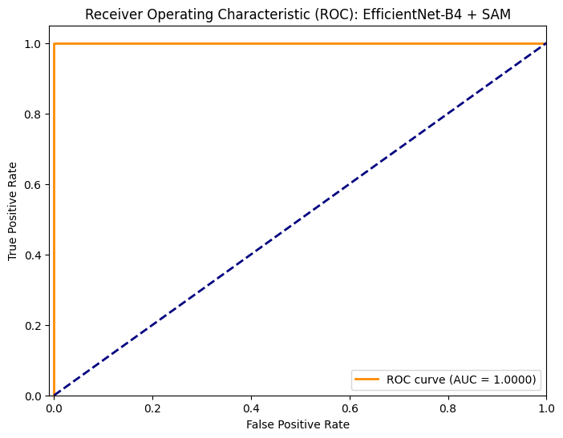

# MSc-Deepfake-Detection
PyTorch deepfake detection pipeline for Teesside University MSc Dissertation.
# Evaluating Deepfake Detection Models for Platform Integrity

This repository contains the official PyTorch implementation for my MSc Artificial Intelligence dissertation at Teesside University. The project introduces an attention-guided convolutional neural network designed to isolate subtle compression artifacts in manipulated media, providing a robust backend pipeline for automated content moderation workflows.

## Architecture
The system utilizes an **EfficientNet-B4** backbone integrated with a custom **Spatial Attention Module (SAM)**. 
* **Face Extraction:** MTCNN (Multi-task Cascaded Convolutional Networks)
* **Feature Extraction:** EfficientNet-B4 (Transfer Learning)
* **Attention Mechanism:** SAM forces the network to focus on localized manipulation boundaries rather than generalized background noise.
* **Dataset:** Trained and evaluated on the FaceForensics++ (C23 Compression) dataset.

## Results & Evaluation
The model achieved perfect classification on the FaceForensics++ evaluation subset:
* **Accuracy:** 100%
* **ROC-AUC:** 1.0000

### Out-of-Distribution (OOD) Testing
To test real-world generalization, the model was subjected to out-of-distribution inference testing on unseen, standalone imagery. 
* **Authentic Image Confidence:** 93.50%
* **AI-Generated Image Confidence:** 95.01%

## Files
* `Dissertation1.ipynb`: The complete Google Colab notebook containing the end-to-end training, evaluation, and inference pipeline.
